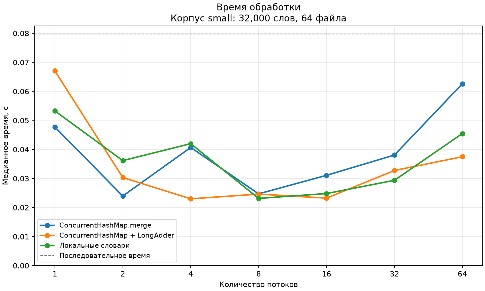
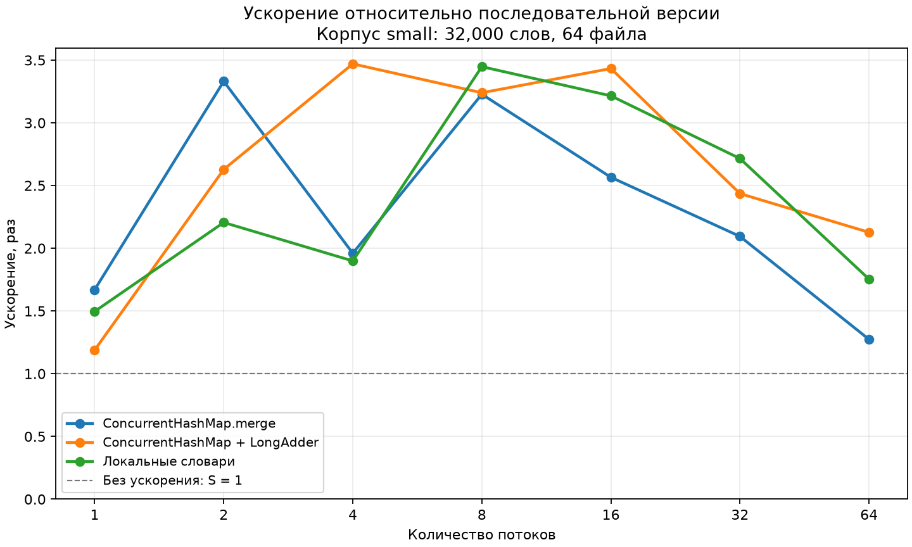
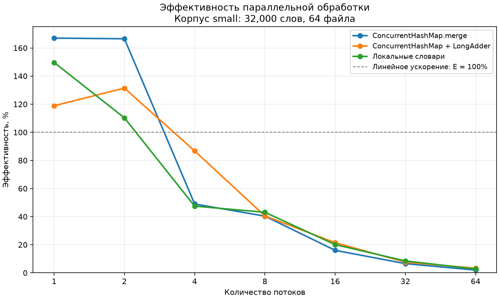
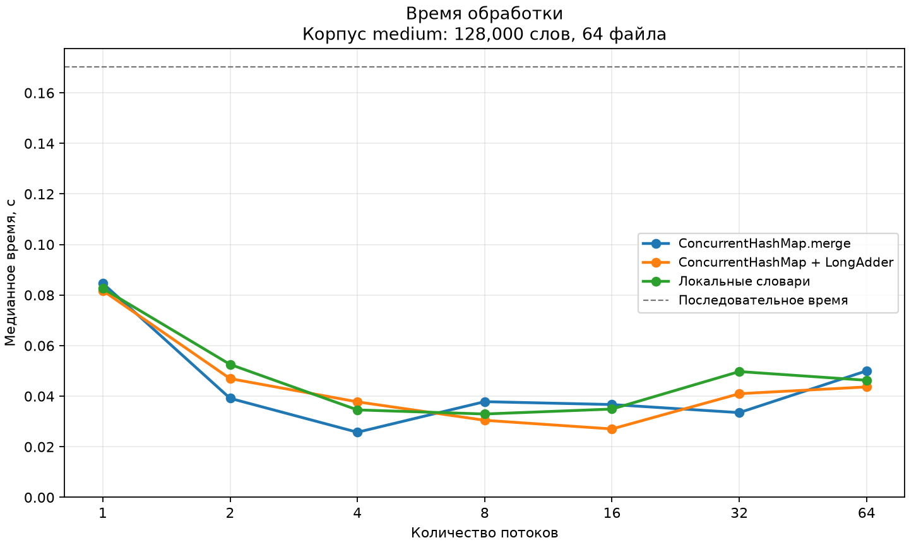
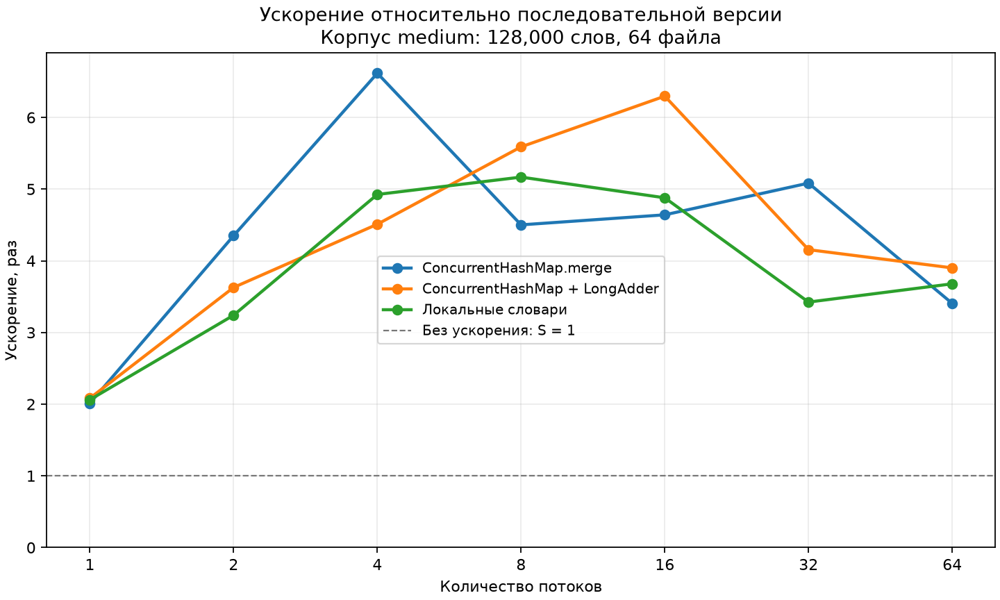
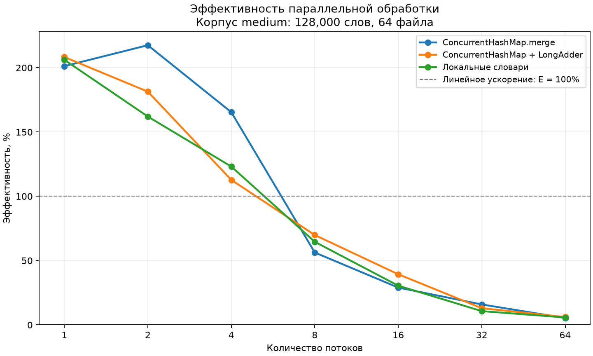
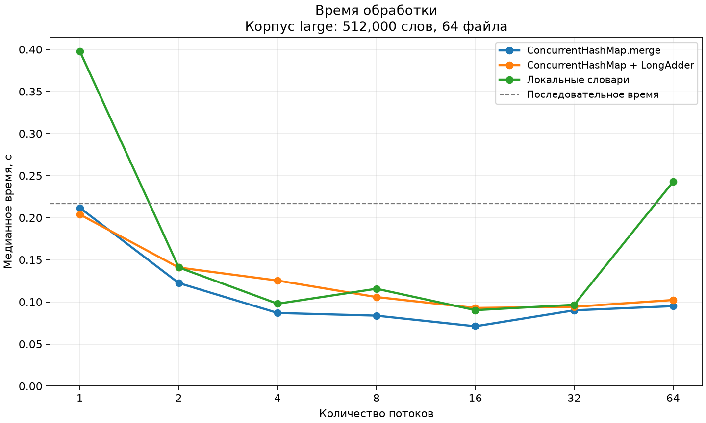
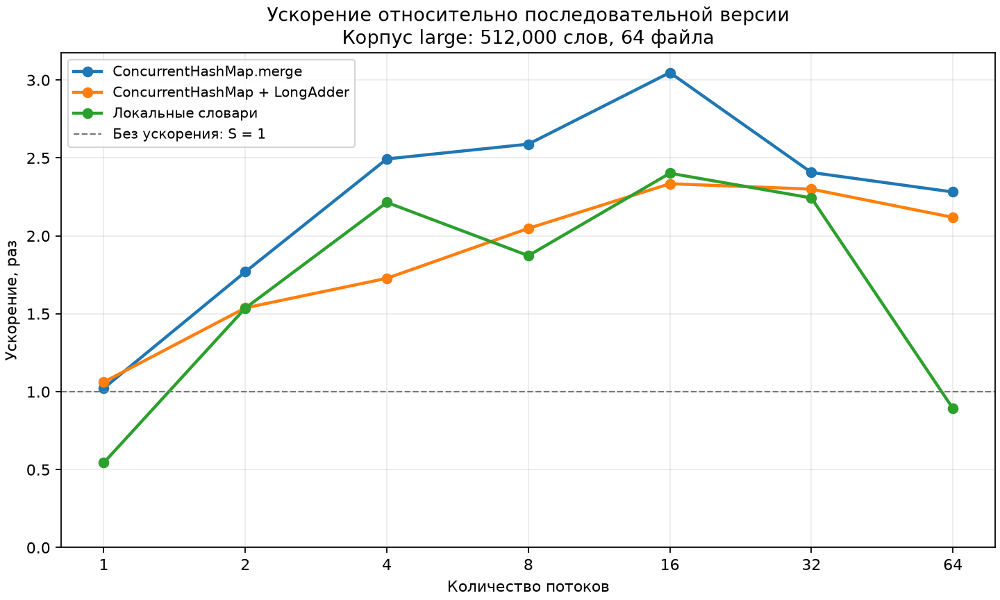
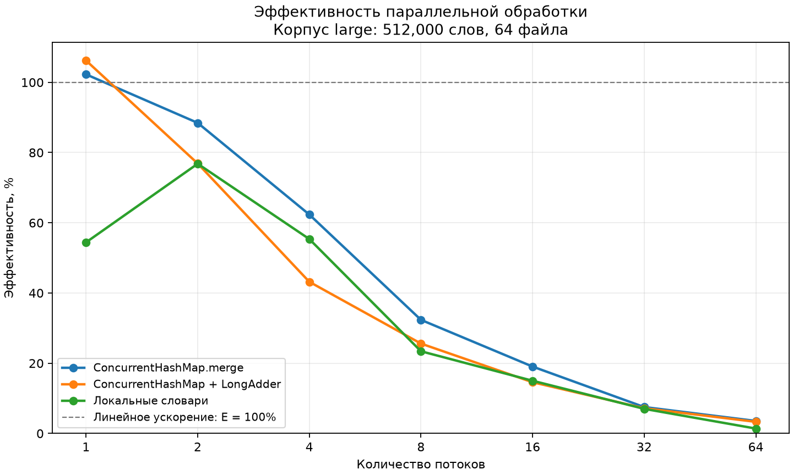

# Выводы по лабораторной №2

Все приведённые числа получены запуском программы. Для каждой конфигурации выполнены 2 прогрева и 5 измерений. Время — медиана; ускорение рассчитано относительно последовательной версии того же корпуса. Проверены все основные и прогревочные запуски.

На графиках показаны только алгоритмически корректные параллельные варианты. Последовательная версия обозначена горизонтальной линией. Ошибочные реализации сохранены в таблицах с фактической проверкой.

## Корпус small

- Файлов: 64; слов: 32000; словарь: 500 слов.
- JVM: 26.0.2+10; ОС: Windows 10 amd64; доступно логических процессоров: 4.
- Последовательная версия: 0.079742 с.
- Минимум среди корректных параллельных вариантов: **long-adder, 4 потоков, 0.022980 с**, ускорение 3.470, эффективность 86.75%.

- concurrent-merge: лучшее время 0.023941 с при 2 потоках; при 64 потоках — 0.062617 с.
- long-adder: лучшее время 0.022980 с при 4 потоках; при 64 потоках — 0.037489 с.
- local-maps: лучшее время 0.023130 с при 8 потоках; при 64 потоках — 0.045471 с.

### Проверка наивных реализаций

- hashmap: совпало с эталоном 0 из 30 многопоточных измерений.
- synchronized-map: совпало с эталоном 2 из 30 многопоточных измерений.
- concurrent-get-put: совпало с эталоном 0 из 30 многопоточных измерений.

[Таблица](small/timings.md) · [Все замеры](small/samples.csv)

## Корпус medium

- Файлов: 64; слов: 128000; словарь: 500 слов.
- JVM: 26.0.2+10; ОС: Windows 10 amd64; доступно логических процессоров: 4.
- Последовательная версия: 0.170356 с.
- Минимум среди корректных параллельных вариантов: **concurrent-merge, 4 потоков, 0.025745 с**, ускорение 6.617, эффективность 165.43%.

- concurrent-merge: лучшее время 0.025745 с при 4 потоках; при 64 потоках — 0.050028 с.
- long-adder: лучшее время 0.027055 с при 16 потоках; при 64 потоках — 0.043670 с.
- local-maps: лучшее время 0.032966 с при 8 потоках; при 64 потоках — 0.046304 с.

### Проверка наивных реализаций

- hashmap: совпало с эталоном 0 из 30 многопоточных измерений.
- synchronized-map: совпало с эталоном 0 из 30 многопоточных измерений.
- concurrent-get-put: совпало с эталоном 0 из 30 многопоточных измерений.

[Таблица](medium/timings.md) · [Все замеры](medium/samples.csv)

## Корпус large

- Файлов: 64; слов: 512000; словарь: 500 слов.
- JVM: 26.0.2+10; ОС: Windows 10 amd64; доступно логических процессоров: 4.
- Последовательная версия: 0.216529 с.
- Минимум среди корректных параллельных вариантов: **concurrent-merge, 16 потоков, 0.071045 с**, ускорение 3.048, эффективность 19.05%.

- concurrent-merge: лучшее время 0.071045 с при 16 потоках; при 64 потоках — 0.094906 с.
- long-adder: лучшее время 0.092749 с при 16 потоках; при 64 потоках — 0.102200 с.
- local-maps: лучшее время 0.090151 с при 16 потоках; при 64 потоках — 0.242623 с.

### Проверка наивных реализаций

- hashmap: совпало с эталоном 0 из 30 многопоточных измерений.
- synchronized-map: совпало с эталоном 0 из 30 многопоточных измерений.
- concurrent-get-put: совпало с эталоном 0 из 30 многопоточных измерений.

[Таблица](large/timings.md) · [Все замеры](large/samples.csv)

## Влияние размера задачи

| Вариант | Потоков | Малый: ускорение | Средний: ускорение | Большой: ускорение |
|---|---:|---:|---:|---:|
| concurrent-merge | 4 | 1.960 | 6.617 | 2.494 |
| concurrent-merge | 8 | 3.228 | 4.502 | 2.588 |
| long-adder | 4 | 3.470 | 4.510 | 1.728 |
| long-adder | 8 | 3.240 | 5.590 | 2.048 |
| local-maps | 4 | 1.899 | 4.926 | 2.215 |
| local-maps | 8 | 3.448 | 5.168 | 1.873 |

При увеличении корпуса растёт объём полезной работы на один запуск потоков. Доля расходов на создание пула, распределение файлов и объединение уменьшается. Однако улучшение не обязано быть монотонным: остаются ограничения диска, CPU, памяти и конкуренция за частые слова. В этой серии при изменении размера генератор создавал новое распределение; поэтому различия обусловлены и объёмом, и составом корпуса.

## Объяснение результатов и ограничения

HashMap не предназначен для конкурентных изменений. synchronizedMap защищает отдельные вызовы get и put, но между ними другой поток может обновить тот же счётчик. ConcurrentHashMap с get/put имеет ту же проблему составной операции. Например, два потока читают 10 и оба записывают 11: одно обновление потеряно. Совпадение отдельных запусков synchronizedMap с эталоном не делает алгоритм корректным.

merge атомарно объединяет значение одного ключа. В отличие от единой блокировки synchronizedMap, ConcurrentHashMap позволяет конкурентную работу с разными участками структуры, хотя обновления одного популярного ключа могут конкурировать. LongAdder распределяет обновления счётчика и может уменьшать конкуренцию; sum вызывается после завершения всех работников. Локальные словари полностью убирают общий изменяемый словарь из основного цикла, но требуют памяти и финального объединения.

Рост числа потоков ограничен числом доступных ядер, пропускной способностью ввода, затратами на создание/переключение потоков и работой планировщика. Файлов 64: каждый из 64 работников получает файл; при меньшем числе потоков каждый читает несколько файлов. Объём данных внутри одной серии не меняется.

Это учебный end-to-end замер с чтением файлов. Дисковый кэш ОС не очищался. Варианты выполнялись в фиксированном порядке в одной JVM; JIT и сборка мусора могут влиять на сравнение даже после двух прогревов. Поэтому ускорение выше числа потоков или E > 100% нельзя считать доказательством сверхлинейного масштабирования. Фоновая нагрузка не контролировалась полностью; близкие времена не доказывают устойчивого преимущества одного алгоритма.

Ускорения ошибочных алгоритмов приведены только для полноты таблицы: они не характеризуют скорость корректного решения.
